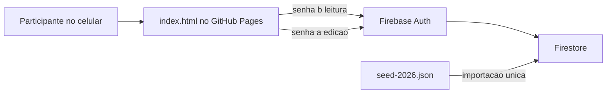
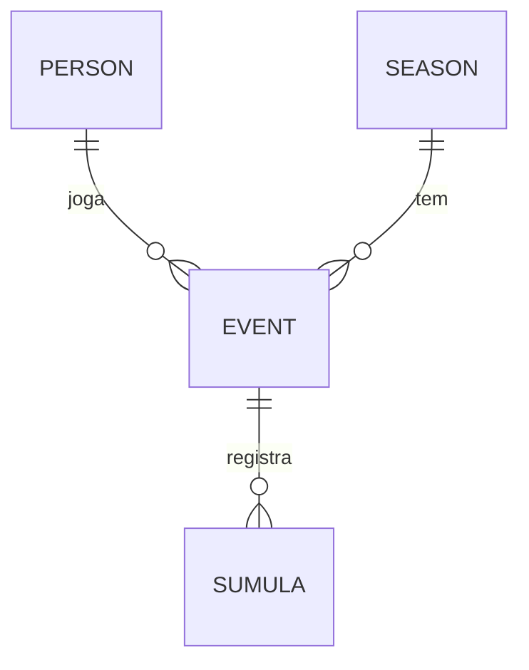

# PRD - Baravilhosas: placar e ranking de tranca

| Item | Valor |
|---|---|
| Cliente | Magali Bernal |
| Produto | App web Baravilhosas |
| Versão do documento | 1.0 |
| Data | 10/11/2026 |
| Referências | `docs/referencias/` (prompt, áudio, planilha 2026, logo, cartas, súmulas) |

---

## 1. Contexto

Um grupo de 21 amigas se reúne uma vez por mês para jogar tranca em duplas. Quando falta gente para fechar uma mesa, entram convidadas. Ao fim de cada encontro, a pontuação gera um **ranking do dia**, e a soma dos encontros forma o **ranking geral do ano**.

Hoje a Magali controla tudo numa planilha Excel, com uma aba por encontro. Depois de cada encontro, ela tira um print do ranking do dia e do ranking geral, envia ao grupo e leva impresso no encontro seguinte. Com o tempo, as fórmulas da planilha passaram a dar valores errados no "Geral" das abas mensais (ver seção 10).

## 2. Objetivo

Ter uma aplicação de leitura fácil em que todas as participantes consultem a pontuação e o ranking, com uma só pessoa responsável por lançar os dados.

**Metas de sucesso**
- Lançar os pontos de um encontro em menos de 10 minutos, direto pelo celular.
- Ranking do dia e geral calculados automaticamente, sem fórmula manual.
- Gerar a versão para imprimir e a imagem para o WhatsApp com um clique cada, no lugar do print manual.
- Histórico de cada ano preservado e consultável depois da virada do ano.

## 3. Personas e acesso

| Persona | Acesso | O que faz |
|---|---|---|
| Editora (Magali) | Senha **"a"** | Cadastra jogadoras e convidadas, cria encontros, lança pontos, corrige dados e inicia um novo ano |
| Participante | Senha **"b"** | Consulta rankings, encontros e histórico, imprime e compartilha |

Nenhuma tela de dados abre sem uma das duas senhas.

## 4. Escopo

### 4.1 Dentro do MVP
MVP é a primeira versão do app, só com o essencial.

1. **Encontros**: data, local, anfitriãs e convidadas presentes. Status "agendado" ou "realizado".
2. **Lançamento de pontos**, de duas formas:
   - **Súmula do jogo**: duas duplas, até 4 rodadas por jogo, com parciais, total e diferença calculados pelo app e conversão automática pela tabela da seção 5.1.
   - **Lançamento direto**: o ponto de cada jogadora em cada jogo da noite (1º a 4º). Serve para o histórico importado e para correções.
3. **Rankings**:
   - Ranking do dia (por encontro).
   - Ranking geral do ano (acumulado).
   - Chave **"Só o grupo / Com convidadas"** nos dois rankings. O padrão é "Só o grupo", que é o ranking oficial.
   - Evolução de cada jogadora encontro a encontro.
   - Filtros por ano, encontro e jogadora.
4. **Identificação visual**: ícone de flor para as integrantes do grupo e ícone de carta com o selo "Convidada" para as convidadas, em todas as telas, na impressão e na imagem.
5. **Impressão e compartilhamento**: versão A4 para imprimir e botão "Salvar imagem" (PNG) para o ranking do dia e o geral.
6. **Temporadas anuais**: ação "Iniciar novo ano", só para a editora. O ranking recomeça do zero, o ano anterior fica arquivado em modo só leitura, e um seletor de ano permite consultar anos anteriores.
7. **Cadastro de pessoas**: integrantes fixas e convidadas, com nome de exibição e tipo. Uma convidada pode passar a integrante sem perder o histórico.

### 4.2 Fora do MVP (backlog)
- Aniversários (os dados estão na aba `Ranking`, colunas U a W).
- Contas e rateio (aba `contas`: kit Baravilhosas, kit de 6 mesas, Rummikub).
- Sorteio de duplas e mesas.
- Notificações.

## 5. Regras de negócio

### 5.1 Conversão da diferença em pontos (súmula)
Cada jogo é disputado entre duas duplas. Ao fim das rodadas, calcula-se a diferença entre os totais, e cada integrante da dupla recebe os pontos da faixa:

| Diferença | Vencedoras | Perdedoras |
|---|---|---|
| 0 a 100 | 10 | 10 |
| 110 a 300 | 11 | 9 |
| 310 a 500 | 12 | 8 |
| 510 a 800 | 13 | 7 |
| 810 a 1000 | 14 | 6 |
| 1010 a 1300 | 15 | 5 |
| 1310 a 1500 | 16 | 4 |
| 1510 a 1800 | 17 | 3 |
| 1810 a 2000 | 18 | 2 |
| 2010 a 2300 | 19 | 1 |
| 2310 a 2500 | 20 | 0 |
| 2510 a 2800 | 21 | -1 |
| 2810 ou mais | 22 | -2 |

- Na tranca, os pontos andam de 10 em 10, então as faixas não deixam buracos. Se aparecer um valor entre faixas (por exemplo, 105), ele entra na faixa de baixo.
- A súmula impressa traz "12810 ou +". Isso é erro de digitação de 2810, confirmado pelas súmulas preenchidas.
- Exemplos reais conferidos: 4890 - 3630 = 1260, que dá 15 e 5. 4030 - 2420 = 1610, que dá 17 e 3.
- Os totais da súmula podem ser negativos (há rodadas com -220 e -360).
- A tabela fica guardada como configuração da temporada, para poder mudar em anos futuros sem alterar o código.

### 5.2 Totais
- **Total do dia** = soma dos pontos da jogadora nos jogos da noite (normalmente 3, até 4).
- **Geral do ano** = soma dos totais do dia de todos os encontros realizados na temporada.
- Os totais são sempre **calculados** a partir dos pontos de cada jogo, nunca digitados.
- Falta (jogadora ausente) conta zero e aparece como "-" na tela.

### 5.3 Ranking e desempate
- Ordem decrescente de pontos.
- Empate: quem empata divide a posição e a seguinte é pulada (1º, 2º, 2º, 4º). É o mesmo comportamento da função `RANK` do Excel usada hoje. As empatadas aparecem em ordem alfabética.
- Há empates em praticamente todo encontro de 2026. Exemplos: março, Ana Dayse, Lorena e Pati com 35; julho, Angela e Miriam com 45; outubro, Renata e Sabine com 41.

### 5.4 Convidadas
- Aparecem no ranking do dia e no geral só no modo "Com convidadas".
- No modo "Só o grupo", as posições são recalculadas sem elas, e não ficam buracos na numeração.
- Cada convidada é cadastrada uma vez e reaproveitada nos encontros seguintes.

### 5.5 Temporadas
- Uma temporada por ano civil.
- Ao "Iniciar novo ano", a lista de integrantes é copiada para a nova temporada. Convidadas não são copiadas, mas continuam no cadastro.
- A temporada arquivada fica só para leitura. Para corrigir algo nela, a editora precisa reabri-la de forma explícita.

## 6. Requisitos funcionais

| ID | Requisito | Quem |
|---|---|---|
| RF01 | Entrar com senha "a" (edição) ou "b" (leitura) | Todas |
| RF02 | Ver o ranking geral da temporada atual na tela inicial | Todas |
| RF03 | Ver a lista de encontros e abrir o ranking do dia de cada um | Todas |
| RF04 | Alternar entre "Só o grupo" e "Com convidadas" | Todas |
| RF05 | Ver a ficha da jogadora com a evolução por encontro | Todas |
| RF06 | Filtrar por ano, encontro e jogadora | Todas |
| RF07 | Imprimir em A4 o ranking do dia ou o geral | Todas |
| RF08 | Salvar o ranking do dia ou o geral como imagem PNG | Todas |
| RF09 | Criar, editar e excluir encontros (data, local, anfitriãs, convidadas) | Editora |
| RF10 | Lançar um jogo pela súmula, com conversão automática | Editora |
| RF11 | Lançar ou corrigir pontos diretamente por jogadora e jogo | Editora |
| RF12 | Cadastrar e editar integrantes e convidadas | Editora |
| RF13 | Iniciar novo ano e arquivar o anterior | Editora |
| RF14 | Consultar temporadas arquivadas | Todas |

## 7. Requisitos não funcionais

- **Formato**: um único arquivo `index.html` na raiz, com CSS e JS embutidos, publicado no GitHub Pages a partir de um repositório próprio. A pasta do projeto pode ser renomeada sem quebrar nada, porque todos os caminhos são relativos.
- **Responsivo**: pensado primeiro para o celular, funcionando também em tablet e desktop. Tabelas com rolagem horizontal ou formato de cartão em telas estreitas.
- **Legibilidade**: público adulto e de mais idade. Texto base de pelo menos 16 px, números do ranking maiores, contraste AA, áreas de toque de pelo menos 44 px.
- **Desempenho**: tela inicial carregada em menos de 3 s no 4G.
- **Isolamento**: projeto Firebase exclusivo para o Baravilhosas, sem dados de outros projetos.
- **Organização**: só o `index.html` na raiz, todo o resto em pastas.

## 8. Arquitetura



- **Hospedagem**: GitHub Pages, sem custo.
- **Dados**: Firebase Firestore (plano gratuito). As alterações da editora aparecem em tempo real para todas.
- **Senhas**: as senhas "a" e "b" correspondem a duas contas fixas no Firebase Auth (por exemplo, `editora@baravilhosas` e `leitura@baravilhosas`). A tela pede só a senha. As **regras de segurança do Firestore** liberam escrita apenas para a conta de edição e leitura para as duas. Assim a proteção não depende de esconder a senha no JavaScript.
- **Bibliotecas**: o SDK do Firebase e a biblioteca de captura de imagem (`html2canvas` ou equivalente) são carregados por CDN.

### Estrutura de pastas

```
index.html                 app completo (único arquivo na raiz)
assets/img/                logo otimizado para web
data/seed-2026.json        histórico de 2026 recalculado, para importação
firebase/firestore.rules   regras de segurança do banco
docs/PRD.md                este documento
docs/CONFIGURACAO.md       passo a passo de Firebase e GitHub
docs/referencias/          prompt, áudio, planilha, imagens originais
```

Sem o `firebaseConfig` preenchido, o app abre em **modo demonstração**: carrega `data/seed-2026.json`, guarda as alterações só no navegador e oferece entrada como editora ou visualização sem senha.

## 9. Modelo de dados



| Caminho no Firestore | Campos principais |
|---|---|
| `persons/{id}` | `id`, `name`, `type` (`membro` ou `convidada`) |
| `seasons/{ano}` | `year`, `status` (`ativa` ou `arquivada`), `members[]` (ids das integrantes da temporada), `scoreTable[]` (faixas da seção 5.1) |
| `seasons/{ano}/events/{id}` | `date`, `hosts` (texto), `location`, `guests[]`, `status`, `scores` (mapa `idDaPessoa -> [1º, 2º, 3º, 4º jogo]`), `sumulas[]` |
| item de `sumulas[]` | `game`, `table`, `pairA[]`, `pairB[]`, `roundsA[]`, `roundsB[]`, `totalA`, `totalB`, `difference`, `pointsA`, `pointsB` |

- `scores` é a fonte única dos pontos. A súmula grava o registro completo e também preenche `scores` das 4 jogadoras naquele jogo. O lançamento direto edita `scores`.
- Quem é integrante é definido por temporada (`members`). Assim, mudar alguém de convidada para integrante não altera anos arquivados.
- Rankings e totais não são gravados. O app calcula tudo a partir de `scores`, o que evita que se repita a divergência da planilha.

## 10. Migração dos dados de 2026

### 10.1 Fonte
`docs/referencias/tabela baraho 26.xlsx`. Da planilha, importam-se **apenas os pontos por jogo** de cada jogadora em cada encontro. Todos os totais e rankings são recalculados.

### 10.2 Encontros importados

| Data | Anfitriãs | Local | Convidadas com pontos |
|---|---|---|---|
| 26/02/2026 | Mirian e Ana | - | Manoela, Ana A |
| 19/03/2026 | Angela e Adri | Petit Carneiro, 979 | - |
| 23/04/2026 | Sabine e Maga | Casa da Sabine | Kelly |
| 21/05/2026 | Vania e Marisa | - | - |
| 18/06/2026 | Lorena e Helena | - | Kelly, Lu Camargo, Monica |
| 23/07/2026 | Dayse e Cris | - | Neide, Monica |
| 20/08/2026 | Pati e Mari | - | Kelly, Monica, Lucinha |
| 17/09/2026 | Renata e Nelise | - | (Claudia, Monica e Kelly listadas, sem pontos) |
| 22/10/2026 | Adri e Larissa | - | Kelly, Claudia |

A aba `NOV` é cópia de outubro e **não** é importada. Novembro e os meses seguintes são criados pela editora no app, como todo encontro novo.

### 10.3 Correções aplicadas
A cliente já sabia das divergências e optou por usar direto os valores recalculados. Este anexo é só para registro.

1. **"Geral" das abas mensais inflado a partir de julho.** De julho a setembro, a coluna "Geral" puxa `Ranking!O`, que já é o total do ano inteiro, inclusive do próprio mês e dos seguintes. O mês acaba sendo somado de novo. Em outubro, a coluna foi digitada à mão com o valor (já inflado) de setembro. Resultado: o "GERAL" da aba de outubro mostra, por exemplo, Miriam com 426, quando o correto é 328.
2. **O total anual da aba `Ranking` (coluna O) está correto.** Ele bate exatamente com o recálculo.
3. **Datas erradas**: o cabeçalho do `Ranking` mostra 26/02/2025 e 28/03/2025, e as abas de abril e maio têm no topo as datas 19/03 e 19/05. A data certa vem do nome de cada aba.
4. **4ª rodada**: nenhum encontro de 2026 teve 4º jogo, então a fórmula de setembro e outubro que a deixa de fora não mudou nenhum valor.
5. **Grafia de nomes padronizada**: "KELLY" e "Kelly" viram a mesma pessoa, e "Adriana M. Rocha" e "Adriana M. R." também. Os nomes completos de fevereiro passam ao nome curto usado no resto do ano.

### 10.4 Ranking geral 2026 recalculado (até outubro, só o grupo)

| Pos. | Jogadora | Pontos | "GERAL" na aba de outubro |
|---|---|---|---|
| 1 | Miriam | 328 | 426 |
| 2 | Sabine | 316 | 379 |
| 3 | Priscila | 302 | 343 |
| 4 | Ana Dayse | 293 | 335 |
| 5 | Renata | 290 | 361 |
| 6 | Helena | 270 | 325 |
| 7 | Mari | 259 | 307 |
| 8 | Pati | 242 | 280 |
| 9 | Vania | 218 | 278 |
| 10 | Magali | 210 | 230 |
| 11 | Lorena | 207 | 236 |
| 12 | Nelise | 205 | 232 |
| 13 | Adriana S. | 199 | 280 |
| 14 | Marisa | 191 | 198 |
| 15 | Simone | 179 | 237 |
| 16 | Larissa | 176 | 188 |
| 17 | Adriana M. R. | 171 | 197 |
| 18 | Angela | 147 | 184 |
| 19 | Maria Helena | 134 | 162 |
| 20 | Ana Luiza | 121 | 148 |
| 21 | Cris K | 43 | 43 |

O erro mudava posições: pela aba de outubro, Renata aparecia em 3º e Adriana S. empatada em 8º.

## 11. UX e UI

### 11.1 Identidade visual
- **Logo**: `Baravilhosas.jpeg` (círculo verde-escuro, flor vermelha e o nome na fonte LainieDaySH). A fonte aparece **só dentro do logo**, usado como imagem no topo do app e no cabeçalho da impressão.
- **Tipografia do app**: fontes padrão do sistema (`system-ui`, Segoe UI, Roboto, sans-serif), sem arquivo de fonte para carregar.
- **Paleta** tirada do logo e das cartas:
  - Verde-escuro do fundo, por volta de `#1F2B22`
  - Vermelho da flor, por volta de `#B3123A`
  - Creme das cartas, por volta de `#F3EAD3`
  - Rosa das cartas, por volta de `#E9A0A8`
  - Verde-menta das cartas, por volta de `#A8D5B5`
- **Textura**: padrão discreto de naipes (♠ ♥ ♦ ♣) no fundo, como no logo.
- **Cartões**: os blocos de ranking imitam cartas de baralho antigas (fundo creme, cantos arredondados, sombra leve), inspirados em `Cartinhas.jpeg`.

### 11.2 Ícones
- **Integrante**: flor vermelha estilizada (SVG inline).
- **Convidada**: carta de baralho com o selo "Convidada" (SVG inline mais o texto).
- **Pódio**: destaque visual para o 1º, 2º e 3º lugares.

### 11.3 Telas
1. **Entrada**: logo e um campo de senha.
2. **Início / Ranking geral**: seletor de ano, chave "Só o grupo / Com convidadas" e a lista com posição, ícone, nome e pontos. Botões "Imprimir" e "Salvar imagem".
3. **Encontros**: lista com data, anfitriãs e local. O próximo encontro aparece destacado como agendado.
4. **Ranking do dia**: pontos por jogo, total e posição, com os mesmos botões e a mesma chave.
5. **Jogadora**: total, posição e um pequeno gráfico ou tabela por encontro.
6. **Edição** (só com a senha "a"): criar e editar encontro, lançar pela súmula, lançar direto e cadastrar pessoas.
7. **Temporadas** (só com a senha "a"): iniciar novo ano.

### 11.4 Impressão e imagem
- A folha A4 traz o logo, o título ("Ranking do dia - 22/10/2026" ou "Ranking geral 2026"), a tabela em fonte grande e a data em que foi gerada. Os elementos de navegação ficam de fora.
- A imagem PNG tem o mesmo conteúdo, em formato vertical pensado para o WhatsApp.

## 12. Critérios de aceite

- Importado o histórico de 2026, o ranking geral até outubro é exatamente o da seção 10.4.
- Os rankings do dia de 2026 batem com a soma dos jogos de cada aba da planilha.
- Uma súmula com diferença de 1260 lança 15 pontos para cada vencedora e 5 para cada perdedora.
- Empates mostram a mesma posição e pulam a seguinte.
- A chave "Só o grupo" tira as convidadas e renumera as posições sem buracos.
- Com a senha "b", nenhuma ação de edição aparece, e uma tentativa de escrita direto no Firestore é recusada.
- "Iniciar novo ano" zera o ranking da nova temporada, e o ano anterior continua consultável e sem alteração.
- Sem rolagem horizontal da página em 360 px de largura (tabelas podem rolar dentro do próprio bloco).
- Impressão em A4 cabe numa página para 21 a 26 nomes.

## 13. Riscos

| Risco | Mitigação |
|---|---|
| Vazamento das senhas | As senhas ficam só no Firebase Auth, nunca no código nem nos documentos do repositório público. Para trocar, basta alterar no console do Firebase |
| Limites do plano gratuito do Firebase | O volume do grupo fica muito abaixo do limite |
| A editora lançar um ponto errado | Edição livre dos jogos e totais sempre recalculados |
| Dependência de serviço externo | Exportar a temporada em JSON, como backup |

## 14. Pendências

Nenhuma pendência bloqueia o desenvolvimento. Para a implementação, é preciso:
- Criar o projeto Firebase e o repositório no GitHub (com acesso da cliente).
- Cadastrar no Firebase Auth as duas contas, com as senhas já definidas pela cliente (não registradas aqui).
